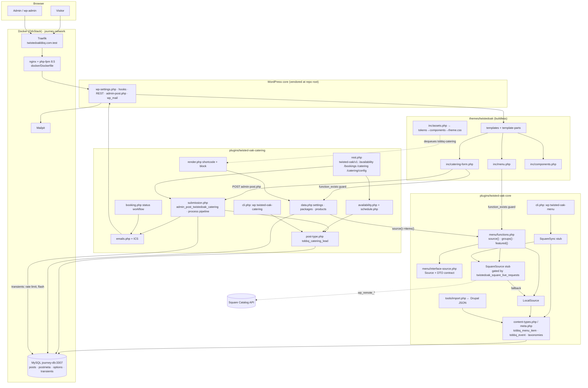

# Onboarding: Twisted Oak BBQ

A map of the repository's architecture, runtime boundaries and dependencies. Each claim cites the file it comes from. Paths are relative to the repo root. For the local environment, WP-CLI commands and conventions, see `CLAUDE.md`.

## 1. Top-level architecture

This is **not a monorepo**. It's a single WordPress install with WP core vendored at the root (`wp-settings.php`, `wp-admin/`, `wp-includes/`). There's no build step, and runtime code has no package dependencies. Composer is used only for dev tooling (PHPUnit, PHPStan; see `docs/testing.md`). All custom code lives in three units.

| Unit | What it does | Evidence |
|---|---|---|
| **twisted-oak-core** (plugin) | Content model (menu items, events, taxonomies, meta) plus the menu "Source" abstraction (Local CPT or Square) | The plugin header in `wp-content/plugins/twisted-oak-core/twisted-oak-core.php:4`. `init` hooks register types and meta (`:36-37`). |
| **twisted-oak-catering** (plugin) | Catering bookings: availability rules, scheduling REST API, lead CPT, emails/ICS, shortcode and block | The plugin header in `wp-content/plugins/twisted-oak-catering/twisted-oak-catering.php:4`. The bootstrap requires 12 `includes/` files (`:23-34`). |
| **twistedoak** (theme) | Classic, buildless PHP theme. PHP ports of the design-system components, plus page templates | `wp-content/themes/twistedoak/functions.php` only `require`s the 9 files in `inc/`. `inc/assets.php:2-4` says "No build step… versioned by modification time". |
| **Infra** | Docker: php-fpm 8.5 + nginx under supervisord. External MySQL, Mailpit and Traefik | `docker/Dockerfile:1` (`php:8.5-fpm-alpine`, installs WP-CLI). `docker-compose.yml` uses the external `journey-network` network and Traefik labels for `twistedoakbbq.com.test`. `wp-config.php:21` sets `DB_HOST journey-db:3307`. |

## 2. Directory map

| # | Directory | Responsibility |
|---|---|---|
| 1 | `wp-content/themes/twistedoak/` | Templates (`front-page.php`, `page-catering.php`, `archive-tobbq_*.php`, `single-tobbq_*.php`) |
| 2 | `wp-content/themes/twistedoak/inc/` | One concern per file: setup, assets, content, customizer, components, navigation, menu, events, catering-form |
| 3 | `wp-content/themes/twistedoak/assets/` | `css/tokens.css`, then `components.css`, then `theme.css` (dependency chain at `inc/assets.php:23-31`). Also `js/theme.js` and self-hosted `fonts/` |
| 4 | `wp-content/themes/twistedoak/template-parts/` | Reusable sections: hero, FAQ, packages, testimonials, CTA band, event row |
| 5 | `wp-content/plugins/twisted-oak-core/includes/` | CPTs and taxonomies (`content-types.php`), meta, meta boxes, admin columns, Square settings, CLI |
| 6 | `wp-content/plugins/twisted-oak-core/includes/menu/` | The `Source` interface and DTO contract, `LocalSource`, `SquareSource` (stub), `SquareSync` (stub), and `functions.php` (`source()`, `groups()`, `featured()`) |
| 7 | `wp-content/plugins/twisted-oak-core/tools/` | One-off Drupal import (`import.php`) plus `data/drupal-products.json` |
| 8 | `wp-content/plugins/twisted-oak-catering/includes/` | data, schedule, post-type, availability, emails, booking, settings, admin, render, submission, rest, cli |
| 9 | `wp-content/plugins/twisted-oak-catering/{assets,blocks}/` | The plugin's own form CSS/JS and the `twisted-oak/catering-form` block (`includes/render.php:40`) |
| 10 | `docker/` and `.backups/` | Container build (Dockerfile, nginx, supervisord, xdebug). DB dumps and theme tarballs taken before changes (git-ignored) |
| 11 | `tests/` | PHPUnit + Brain Monkey unit tests (`tests/unit/`), run without WordPress or a database. Config in `phpunit.xml.dist` and `phpstan.neon.dist` |

## 3. Runtime boundaries

### API layer

- **REST** routes live in namespace `twisted-oak/v1` (`wp-content/plugins/twisted-oak-catering/includes/rest.php:20-85`). All four use `permission_callback => '__return_true'`. The code comments say the nonce, honeypot and rate limit are checked in the submission pipeline.
  - `GET /availability` takes `from`, `to` and `guests`. The range is capped at 93 days (`:12`).
  - `POST /bookings` calls `twistedoak_catering_rest_submit($r, true)`, which requires a time slot.
  - `GET /catering/config` returns the public config.
  - `POST /catering` calls `twistedoak_catering_rest_submit($r, false)`.
- **admin-post (no-JS)**
  - `admin_post[_nopriv]_twistedoak_catering` routes to `twistedoak_catering_admin_post` (`includes/submission.php:428-431`).
  - ICS downloads go through `admin_post[_nopriv]_twistedoak_catering_ics` (`includes/emails.php:144-145`).
- **The theme owns the live catering form.** `wp-content/themes/twistedoak/inc/catering-form.php:165-166` posts to `admin-post.php` with `action=twistedoak_catering`. On that page, `inc/assets.php:46-50` dequeues the plugin's wizard assets.
- **Theme-to-plugin calls** are always guarded by `function_exists`: see `inc/menu.php:18,27`, `inc/catering-form.php:16,23,73,97` and `single-tobbq_menu_item.php:14`.

### Domain layer

- **Menu**
  - `wp-content/plugins/twisted-oak-core/includes/menu/interface-source.php:1-38` defines the `TwistedOak\Core\Menu\Source` contract and its DTO shapes.
  - The `source()` selector in `includes/menu/functions.php:24-41` reads the `twistedoak_square_settings` option and the `twistedoak_menu_source` filter. If Square is chosen, it wraps `LocalSource` as the fallback.
- **Catering pipeline:** `twistedoak_catering_process()` (`includes/submission.php:227`) runs these steps in order:
  1. Normalise and validate (`:59`, `:101`).
  2. Apply the rate limit (`:197`).
  3. Store the lead with `store_lead` (`:374`).
  4. Send the admin and customer emails (`:320-322`).
- **Status workflow:** `includes/booking.php:18` defines `twistedoak_catering_set_status()`, which sends a status email (`:51`).
- **Availability:** computed in `includes/availability.php`, with the `twistedoak_catering_day_availability` filter at `:292`.
- **Cross-plugin dependency:** catering builds its package choices from core's menu. `includes/data.php:155-166` calls `\TwistedOak\Core\Menu\source()->items()`. If core isn't loaded, it falls back to querying the CPT directly (`:167`).

### Persistence

Everything is in the WordPress DB. There are no custom tables.

- **CPTs:** `tobbq_menu_item` and `tobbq_event` are registered in `twisted-oak-core/includes/content-types.php:82,113`. `tobbq_catering_lead` is defined in `twisted-oak-catering/includes/post-type.php:12`.
- **Taxonomies:** registered in `content-types.php:20,42,61`, before the CPTs.
- **Options:**
  - `twistedoak_catering_settings` (`includes/data.php:12`)
  - `twistedoak_catering_schedule` (`includes/schedule.php:32`). It's memoised per request and reset by an `update_option_*` hook at `:131`.
  - `twistedoak_square_settings` (`twisted-oak-core/includes/square-settings.php:75`), with autoload off.
- **Transients:**
  - rate-limit hits (`includes/submission.php:198-207`)
  - flash data for no-JS redirects (written at `submission.php:451`, read at `render.php:125`)
  - the Square catalog cache (`class-square-source.php:146,160`)

### Async jobs

There are **none**.

- The custom code has no `wp_schedule_event` or cron calls.
- Email is sent synchronously during the request (`wp_mail` at `includes/emails.php:301`). Locally, Mailpit catches it.
- Square sync runs only by hand, through WP-CLI. A 15-minute cron is a TODO at `class-square-sync.php:22`.
- Live Square HTTP calls (`class-square-source.php:191,209`) are gated by the `twistedoak_square_live_requests` filter, which defaults to false (`:176`).

### Config

- **`wp-config.php`**
  - DB on `journey-db:3307` (`:12-21`)
  - all three `WP_DEBUG*` flags on (`:53-55`)
  - `WP_HOME` and `WP_SITEURL` set to the `.test` host (`:59-60`)
- **Admin settings pages:** catering settings in `twisted-oak-catering/includes/settings.php`, Square settings in `twisted-oak-core/includes/square-settings.php`.
- **Filters:** there are about 30 `apply_filters` extension points. Examples:
  - `twistedoak_catering_product_categories` (`data.php:146`)
  - `twistedoak_catering_email` (`emails.php:297`)
  - the theme's `twistedoak_info`, `twistedoak_faqs` and `twistedoak_copy` (`inc/content.php`)
- **CLI:**
  - `wp twisted-oak-menu` (`twisted-oak-core/includes/cli.php:286`)
  - `wp twisted-oak-catering` (`twisted-oak-catering/includes/cli.php:254`)

## 4. Dependency diagram

## 5. Gotchas

- **Load order:** the catering plugin depends on the core plugin at runtime, not at load time. It checks `function_exists` when it builds its product list, so it still works when core is missing, just with a degraded menu.
- **Two catering frontends:** the plugin ships its own form and wizard (shortcode and block), but the live `/catering` page uses the theme's form. Change markup in the theme and logic in the plugin.
- **Git:** `.gitignore` is a whitelist. WordPress core, `wp-config.php` and uploads are not tracked, so a fresh clone needs core downloaded and a config created (see `README.md`). Any new top-level file, or a plugin not named `twisted-oak-*`, must be whitelisted or it won't be committed.
